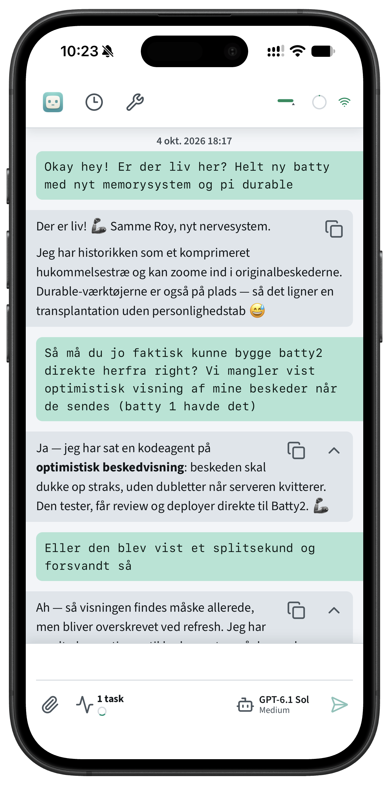

# Batty

A personal assistant and coding agent with **one permanent main thread**. Research, coding, background tasks and scheduled work branch out from that conversation and bring their results back. Persistent memory carries the context forward.

Device frame: [Apple Frames](https://www.macstories.net/shortcuts/) by Federico Viticci / MacStories.

## Pi Durable

[Pi Durable](https://github.com/earendil-works/pi/tree/main/packages/durable) powers execution. Conversations, tasks and result delivery persist in SQLite; committed work resumes after server restarts, including during deployments.

- **Async subagents:** delegate parallel work, `await` results, `steer` running agents and `resume` previous agents for follow-ups.
- **Cron:** scheduled and one-off tasks, with results delivered directly or through the main assistant.
- **Workspaces:** project directories with their own instructions and skills; execution scopes, not separate user chats.
- **Coding tools:** read, write and edit files, search repositories and run shell commands.
- **Browser and web search:** interact with JavaScript-driven pages, capture screenshots and extract readable web content.
- **Codemode, MCP and skills:** compose tool calls in JavaScript, discover external MCP tools and load reusable workflows.
- **Artifacts:** return files, diffs and hosted HTML sites; forward selected artifacts from worker reports.
- **Mobile web app:** installable PWA, passkey login, push notifications, offline history reading and incremental reconnect.
- **Model controls:** choose models and reasoning effort for the main assistant, subagents and scheduled work; inspect token usage.

## OptChat

[OptChat](https://gist.github.com/VictorTaelin/91837951a5ce5b38f341ec1ba1df6449) gives the permanent conversation a navigable memory tree. Main combines summaries of older history with a recent native session tail, including tool calls, results and images. Background summarization moves older runs into the tree in batches, keeping the request prefix stable between rollovers. Original history is retained.

- **Automatic recall:** main user inputs retrieve relevant historical text excerpts through lexical search, with source IDs for opening the originals.
- `memory_zoom` expands summaries with UTC timestamp ranges or retrieves an original timestamp, non-thought text and images at leaf zoom (`n=1`).
- `memory_search` searches original text by keywords; tool calls and results are opt-in.

Workers in the assistant workspace receive a snapshot of the prepared main-memory tree plus all unprepared text projections and original images, marked as historical background rather than their own conversation. Workers in other workspaces receive neither this background nor main-memory tools.

The summarization model and language are configurable; original messages remain unchanged. See [memory architecture and recall](docs/runtime.md#memory) for retention, worker context and retrieval details.

## Documentation

- [Setup, development and operation](docs/operations.md)
- [Runtime, memory and integrations](docs/runtime.md)
- [Moving sites and importing schedules](docs/migration.md)
- [Client API](src/client/API.md)

## License

[MIT](LICENSE) © 2026 David Thomas Nilsson.

## References

- [Pi Durable](https://github.com/earendil-works/pi/tree/main/packages/durable)
- [OptChat specification](https://gist.github.com/VictorTaelin/91837951a5ce5b38f341ec1ba1df6449) ([archived copy](docs/references/optchat-spec.md))
